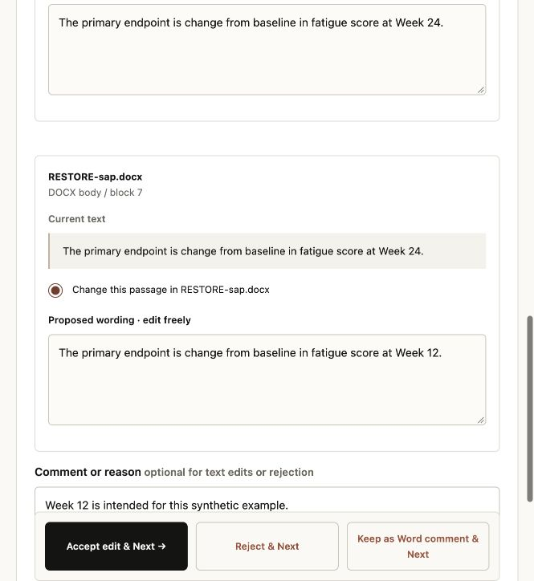

# Protocol and SAP Review Assistant

A practical second look at your clinical trial documents.

A protocol says **Week 12**. The statistical analysis plan says **Week 24**. Which one does the team intend?

Upload a protocol and an optional statistical analysis plan (SAP), then work through the proposed changes one at a time. Accept, edit or reject each suggestion, approve the final version, and download your updated Word documents. You can also take a review copy into Word, with native tracked changes and comments for the team.



**Research preview.** You can try the complete workflow with synthetic documents and no API key. Broader AI review is optional. Use public, synthetic or explicitly authorised redacted documents; confidential partner material and patient-level records are outside this preview.

## From upload to your next draft

1. **Upload your DOCX.** Add a protocol and an optional SAP. You can start directly from the home page without creating a project first.
2. **Review one issue at a time.** See the source passages and alternative wording. When sources conflict, you choose which passage should change; the app does not decide the correct trial detail for you.
3. **Accept, edit or reject.** Adjust the replacement text before accepting, reject the suggestion, or leave a question as a Word comment. Next takes you to the following issue, and you can revisit any decision.
4. **Approve the final preview.** Check the accepted edits, rejected suggestions and remaining comments. Changing a decision invalidates that approval until you approve the new version.
5. **Download the updated document.** Accepted edits are applied to a copy of the original DOCX. Untouched package parts and surrounding text formatting are preserved. Questions kept as comments remain in the copy.

**Prefer to work in Word?** Download a Word review copy at any point. Selected edits appear as native tracked insertions and deletions; open questions appear as anchored comments. Without a selected direction, unresolved discrepancies receive comments. You can also choose the protocol or SAP as a reference to export proposed cross-document edits immediately, without stepping through each issue in the app. These export-only suggestions do not create accepted decisions. Word reviewers can accept or reject them using Word's own review controls.

Table rows and complex passages that cannot be edited safely in the app can receive comments. PDF uploads still support evidence review and reports, but an original DOCX is required for updated-document downloads; the app does not reconstruct a Word original from a PDF. The existing evidence workspace, discussion and separate DOCX review report remain available.

Your original uploads stay unchanged. Updated documents are not independently validated trial designs: check related definitions, schedule entries and assumptions before approving the next draft.

## Try it locally

You need **Python 3.12+** and [uv](https://docs.astral.sh/uv/getting-started/installation/). From the repository directory:

```sh
uv sync --frozen
uv run python manage.py migrate
uv run python manage.py seed_demo
uv run python manage.py runserver 127.0.0.1:8000
```

Open **[localhost:8000](http://127.0.0.1:8000)**. Sign in as `demo` using the generated password printed by `seed_demo`. The demo includes a synthetic study with three deliberate discrepancies.

The development server starts the review worker automatically, including for uploads and new runs. Stop the server to stop its worker. If you already run a separate worker, use `runserver --no-worker` to avoid starting another one. Hosted deployments still need a separate worker.

Local development uses SQLite and one worker. Running `seed_demo` again preserves the existing account and review. To reset its password:

```sh
uv run python manage.py changepassword demo
```

## Documents to test with

[Download the example pack](examples/pipeline-test-pack.zip) or read the [case guide and expected results](examples/pipeline-test-pack/README.md).

It contains **13 DOCX files and 3 PDFs**, covering matching documents, deliberate discrepancies, equivalent wording, a protocol-only review, contextual questions, embedded instructions and unsupported inputs.

Start with the pair in **`02_discrepancies`**. Local mode should flag:

- A primary assessment at Week 12 versus Week 24.
- Intention-to-treat versus per-protocol primary analysis populations.
- A planned randomised total of 120 versus 100 participants.

Unzip the pack and upload one case at a time. The answer key separates local-check expectations from cases that need AI review.

## Choose the review mode

| | Local checks | AI review |
| --- | --- | --- |
| Setup | No API key needed | Anthropic API key and model required |
| Checks | Three narrow patterns: explicit primary endpoint timing, named primary analysis populations and stated randomised totals | Contextual review across the eight check areas in the PRD |
| Discussion | Retrieves passages and explains existing findings | Answers questions using retrieved source evidence and recorded context |
| Limits | Other check areas are marked unassessed | Bounded document context, extraction limitations and model uncertainty still apply |

To enable AI, export `ANTHROPIC_API_KEY` and `ANTHROPIC_MODEL` in **both** the web and worker environments, then start a new review run. Choose a model that supports structured outputs. The provider receives extracted text and selected discussion context, so check your authorisation and its processing terms first.

See [.env.example](.env.example) for configuration. Django does not automatically load `.env`; Docker Compose does.

## What it is designed to review

The current scope is English-language, two-arm parallel-group randomised superiority trials with a continuous primary endpoint at a fixed time point. Files can be DOCX or text-based PDF, up to 25 MB each and 250 PDF pages. Scans and unresolved tracked changes are unsupported.

Findings are issues and questions for your team, not a verdict on the trial. Quotations are checked against extracted source text, and incomplete checks are disclosed. No findings does **not** mean a trial has passed review.

The preview has not completed the PRD's expert evaluation or unaided usability release gates. Live AI calls are mocked in automated tests. See [operations and remaining work](docs/OPERATIONS.md) for the practical limits.

## Development and setup

The application uses **Django**, server-rendered pages, a separate background worker and private file storage. SQLite makes local setup easy; PostgreSQL is supported for shared environments.

Run the checks:

```sh
uv run ruff check .
uv run ruff format --check .
uv run python manage.py makemigrations --check --dry-run
uv run python manage.py test
```

GitHub CI runs the tests on SQLite and PostgreSQL and checks deployment settings. The test suite includes the upload-ready example documents.

There is no public signup. Create an administrator with `uv run python manage.py createsuperuser`, then manage accounts at `/admin/`. Project owners can grant or revoke access for existing accounts and delete their project's files and review records.

<details>
<summary><strong>Run with Docker Compose</strong></summary>

Create a local `.env` with a strong `SECRET_KEY` and a URL-safe `POSTGRES_PASSWORD`, then run:

```sh
docker compose build
docker compose run --rm web .venv/bin/python manage.py migrate
docker compose run --rm web .venv/bin/python manage.py seed_demo
docker compose up
```

Compose runs a local web server, worker and PostgreSQL database, with persistent volumes for the database and private files. It binds the web server to loopback. Hosted deployment needs TLS, static-file serving and the data controls described in the [operations guide](docs/OPERATIONS.md).

</details>

## Project notes

- [Product requirements](docs/PRD.md) — the intended experience and release gates.
- [PRD review](docs/PRD-REVIEW.md) — assumptions and decisions to confirm.
- [Build plan](docs/BUILD-PLAN.md) — architecture and implementation approach.
- [Delivery backlog](docs/BACKLOG.md) — milestones and acceptance criteria.
- [Operations guide](docs/OPERATIONS.md) — current behavior, configuration and remaining work.
