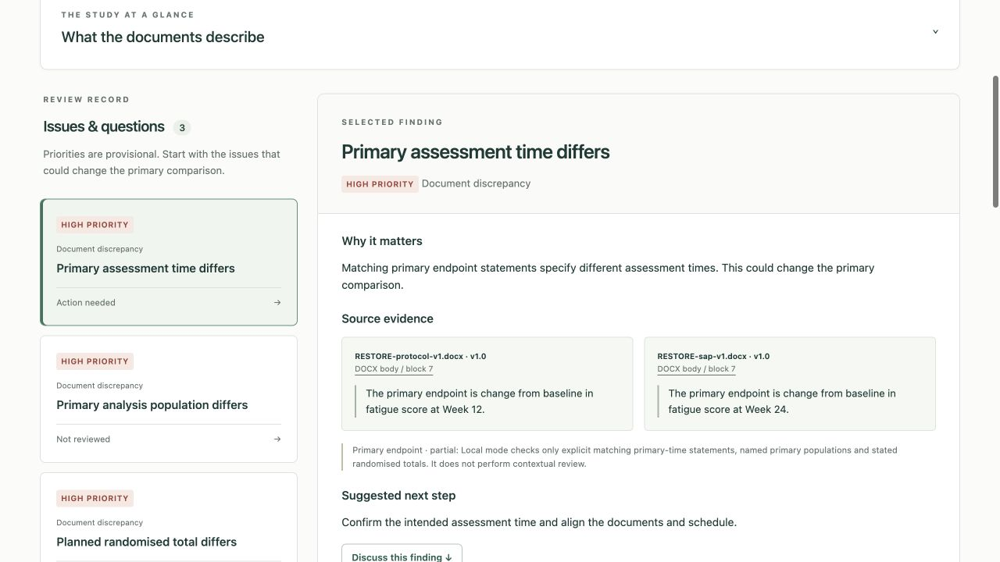

# Protocol and SAP Review Assistant

An evidence-linked workspace for reviewing a clinical trial protocol and optional statistical analysis plan. Upload DOCX/text PDF, confirm versions and scope, inspect prioritised findings with source passages, discuss the evidence, record decisions, and export a DOCX report.

**Status: working research preview for public, synthetic or explicitly authorised redacted documents.** Confidential partner material and patient-level records are not accepted. This implementation has not met the PRD's expert-evaluation or clinical usability release gates.



## Run locally

Requires Python 3.12+ and [uv](https://docs.astral.sh/uv/getting-started/installation/).

```sh
uv sync --frozen
uv run python manage.py migrate
uv run python manage.py seed_demo
uv run python manage.py review_worker --once
uv run python manage.py runserver 127.0.0.1:8000
```

Open [localhost:8000](http://127.0.0.1:8000) and sign in with username `demo` and the generated password printed by `seed_demo`. It creates a synthetic study with three planted discrepancies. Re-running the command preserves the account password and existing review. For a password reset use `uv run python manage.py changepassword demo`.

For uploaded documents and reruns, keep the worker running in a **second terminal**:

```sh
uv run python manage.py review_worker
```

A new upload extracts first, asks you to confirm metadata and supported trial scope, then runs checks in the background. Reruns create separate review records and preserve earlier decisions. SQLite is a local convenience; use exactly one local worker.

Create real pilot accounts using `uv run python manage.py createsuperuser`, then manage users at `/admin/`. Project owners add existing accounts from project settings. There is no public signup.

## Review modes

**Local mode (default):** works without API credentials. It compares explicit matching primary endpoint statements with different times, named primary analysis populations, and stated total randomised sample sizes. It retrieves source passages for discussion and explains existing findings. It does not perform open-ended clinical interpretation, and explicitly marks the other five check areas unassessed. Summary excerpts link back to source evidence.

**AI mode:** set both `ANTHROPIC_API_KEY` and `ANTHROPIC_MODEL` in the web and worker environments, then start a new run. Choose a currently available model that supports structured outputs; no model is silently selected. AI reviews all eight check areas using bounded supplied content, with exact quotation validation and per-check coverage. Discussion retrieves evidence within the selected run. Failed or unsupported AI responses do not silently fall back to a complete-looking review. The provider receives extracted source text and selected conversation context, so verify its terms and your authorisation first.

Environment variables are documented in [.env.example](.env.example). Django does **not** auto-load this file. Export variables in the shell or use your process manager. Docker Compose reads `.env` itself.

## What is implemented

- Invite-only authentication and project membership; private source storage and authorised downloads.
- Bounded file validation/extraction with hashes, version confirmation, PDF physical-page coordinates and stable DOCX block/table locations.
- Background processing with claims, lease fencing, immutable runs and atomic finding publication.
- Evidence-linked summary, up to five initial findings, remaining findings, all eight coverage records and specific extraction limitations.
- Persistent decisions and notes with stale-write detection and audit history.
- Finding-specific and general discussion; explicit accept/reject for clarification, decision and new-finding proposals.
- DOCX export of accepted state, citations, decisions, notes, clarifications, processing versions and coverage; original files unchanged.
- Project deletion covering source files, extractions, conversations and review records, including retry after file-removal failure.

## Validation

```sh
uv run ruff check .
uv run ruff format --check .
uv run python manage.py makemigrations --check --dry-run
uv run python manage.py test
```

Tests generate their own synthetic files. CI runs the suite on SQLite and PostgreSQL and checks deployment settings. Live AI calls are mocked in tests and require a separately authorised evaluation. See [operations and limitations](docs/OPERATIONS.md) before deploying.

## Docker development

Create a local `.env` containing strong `SECRET_KEY` and URL-safe `POSTGRES_PASSWORD` values, then:

```sh
docker compose build
docker compose run --rm web .venv/bin/python manage.py migrate
docker compose run --rm web .venv/bin/python manage.py seed_demo
docker compose up
```

This binds the development web server to loopback and persists PostgreSQL and private files in volumes. It is not a confidential-data production deployment. The image also provides a Gunicorn entrypoint; supply a TLS reverse proxy/static server and verified data controls for any hosted pilot.

## Product documents

- [Original PRD](docs/PRD.md)
- [PRD review](docs/PRD-REVIEW.md)
- [Architecture plan](docs/BUILD-PLAN.md)
- [Delivery backlog](docs/BACKLOG.md)
- [Implementation status and operations](docs/OPERATIONS.md)
