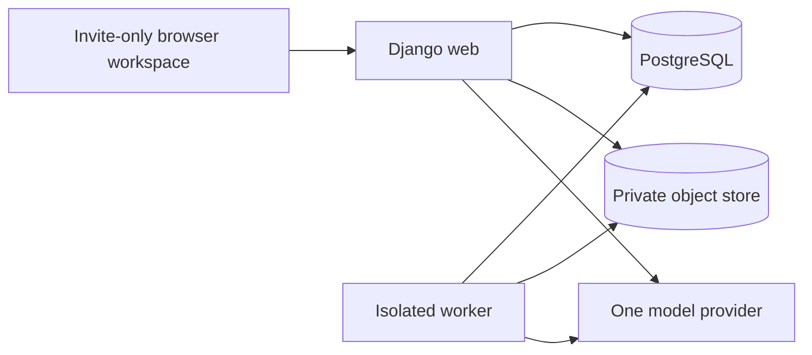

# Build plan

## 1. Proposed architecture

Use a Python monolith with Django 5.2 LTS on its latest supported security patch, server-rendered templates and a small amount of JavaScript for selection, polling, and chat. Use PostgreSQL and private S3-compatible object storage. Run the web process and one isolated background worker from the same application image. This keeps authentication, transactions, migrations, parsing, and DOCX generation in one language and repository.

For a small pilot, implement the worker as a Django management command over a PostgreSQL job table. Claim jobs with row locking and `SKIP LOCKED`; use short transactions, leases, heartbeats, bounded retries, stage checkpoints, and unique idempotency keys. Do not hold a database transaction during parsing or a model call. A lease token fences stale workers from publishing. Persist job creation in the same transaction as its review run. Use a mature queue later if concurrency or routing needs justify another service; this is a bounded pilot choice, not a general-purpose queue project.

Use `pdfplumber` for PDF text, tables, and coordinates; `python-docx` for DOCX traversal and report generation; Pydantic for model-result schemas. Lock actual dependency versions when scaffolding. Use one hosted language-model provider with schema-constrained outputs, selected by evaluation. No browsing or execution tools are available to review/chat calls. Use PostgreSQL full-text search plus field/check tags for contextual retrieval; two documents do not justify a vector service initially.

Alternative considered: a React/Next.js frontend plus Python API. It adds separate build, authentication, and API surfaces before the MVP needs them. Introduce a separate frontend only if measured interaction needs exceed server-rendered screens. A synchronous upload-to-model endpoint is too fragile for long processing and retries.



Chat calls originate on the server, use bounded retrieved context, and persist conversation records. Exports run as jobs over an immutable snapshot of accepted review state.

## 2. Repository layout when implementation starts

```text
config/                  Django settings, URL routing, deployment entrypoints
reviews/                 Models, permissions, views, templates, job command
reviews/extraction/      PDF and DOCX adapters, location and coverage mapping
reviews/pipeline/        Fact schema, checks, evidence verification, ranking
reviews/chat/            Retrieval, responses, proposed-update validation
reviews/reports/         DOCX rendering from accepted state
tests/                   Unit and integration tests
tests/fixtures/synthetic/ Small redistributable document pairs
evals/                   Corpus manifests, rubric, evaluator and release results
docs/                    PRD, decisions, build plan and runbooks
```

Keep these as modules in one application until real boundaries justify splitting. No generic plugin framework or agent orchestration layer.

## 3. Durable data model

Every project-owned record must be reached through membership-scoped queries. IDs alone grant no access.

| Entity | Key fields and invariants |
| --- | --- |
| Project / Membership | Owner, members, lifecycle; all file, job, report, chat and evidence access checks project membership |
| DocumentVersion | Project, role (protocol/SAP), private object key, SHA-256, file type, confirmed title/version/date; immutable original; hash deduplication confined to project |
| Extraction | Document version, parser/version/config, status; immutable blocks and coverage diagnostics; rerunning a parser creates a new extraction |
| SourceBlock | Extraction, ordered block ID, raw extracted text, type, heading path; PDF physical page and bbox or DOCX part/body/paragraph/table/row/cell path |
| ReviewRun | Protocol version, optional SAP version, extraction IDs, scope, job state, model/prompt/check/schema versions, timestamps and failure codes |
| StudyFact | Run, field, typed value, source spans, ambiguity; maintain multiple conflicting assertions rather than selecting one silently |
| CheckAssessment | Run, check ID/version, assessed/partial/not-assessed/not-applicable, scope, reason and relevant blocks |
| Finding / EvidenceSpan | Run, check, type, priority, consequence, action, bounded quoted spans; discrepancy needs at least two conflicting spans; question needs evidence, unknown and affected decision |
| Decision / Clarification | Finding or run, actor, status/note, revision, timestamp; clarification separate from source facts; append history |
| Conversation / Message | Run and optional finding, actor, source/user/interpretation context provenance; access-controlled and deletion-scoped |
| ProposedUpdate | Target, base revision, structured diff, rationale, pending/accepted/rejected; explicit acceptance transaction required |
| Job / Report / AuditEvent | Lease and retry state; report snapshot/revision and object key; content-free audit metadata |

Use foreign keys and constraints to prevent evidence from pointing outside a run's selected extractions. Status enum: `not_reviewed`, `action_needed`, `needs_discussion`, `dismissed`. Do not implement `resolved`. Provisional priority is high/medium/low, with no displayed numerical confidence or quality score.

## 4. Processing and review integrity

1. **Validate uploads.** Enforce authentication, project membership, count, byte/page limits, MIME plus signature checks, DOCX archive expansion limits, and time/memory limits. Reject encrypted/corrupt files, scans without usable text, patient-level records identified during screening, and unsupported types. User attestation and automated screening reduce risk but cannot guarantee detecting all patient data. No document-body logs.
2. **Extract before scope review.** Preserve raw text separately from normalized comparison text. PDF anchors use physical page numbers and bounding boxes; display printed page labels separately when available. DOCX anchors use stable paths within the immutable extraction and document version, never fabricated page numbers. Parse tables with header, row, column and footnote relationships; recursively inspect supported nested structures.
3. **Inspect extraction quality.** Detect tracked-change XML and unsupported parts before accepting DOCX. Identify suspicious/empty pages and broken tables; attach limitations to affected checks. A schedule not confidently reconstructed makes timing checks partial, even when prose is readable. No silent OCR fallback. If no reliable basis remains, stop with an actionable processing message rather than `Review ready`.
4. **Confirm metadata and scope.** Show detected title/version/date with unknowns and conflicting candidates. Confirm metadata without a lengthy summary approval step. Determine eligibility from cited design statements. Ask only material clarifications; stop unsupported designs. An absent SAP makes cross-document checks not applicable, while protocol checks still run.
5. **Extract evidence-linked assertions.** Build the five summary fields plus endpoint measure, time origin/unit/window, population exclusions, treatment-change rules, schedule cells, allocation and sample-size roles. Keep uncertainty and multiple source statements. Clarifications are a separate input layer.
6. **Run bounded checks.** Deterministic rules compare unambiguous typed assertions. Contextual AI examines relevant sections, schedule headers/footnotes and delegated-manual references. It proposes candidates, never final database writes. All eight check families produce a coverage record, including when no candidate is found.
7. **Validate candidates.** Require source block IDs and offsets. Construct displayed quotes from stored text and check model-proposed quotation equality. Validate both discrepancy sides, endpoint identity, time origins, units and document versions. Suppress invalid citations and record affected coverage. Semantic context verification and expert evaluation remain necessary even after exact matching.
8. **Deduplicate and rank.** Group by underlying issue, comparison fields and evidence; merge duplicate descriptions but retain distinct consequences. Rank by documented primary-interpretation or essential-conduct impact. Display at most five initially and provide all remaining findings. No findings is not a pass result.
9. **Publish atomically.** Stage outputs per attempt; only a valid, fenced worker can publish the finished run. Known limitations can coexist with `Review ready` if explicitly disclosed. Failed attempts remain failed; retry creates a new attempt without deleting decisions or replacing previous successful runs.

Review state: `queued → extracting → checking_scope → reviewing → verifying → ready`; `needs_input`, `unsupported`, `failed`, and `cancelled` are explicit alternatives. The user-facing successful label is **Review ready**. Reruns create a new immutable review run; decisions never migrate automatically.

### Check catalogue

| Check | Comparison and boundary |
| --- | --- |
| Trial question | Population, arms and primary outcome across synopsis/body/SAP; exclude secondary endpoint differences |
| Primary endpoint | Definition, measure, assessment time and origin; distinguish visit windows from a different primary time |
| Assessment schedule | Link the actual primary measure to visit cells and footnotes; unreadable table means partial coverage |
| Analysis population | Compare named primary populations and explicit exclusions; equivalent labels alone do not prove equivalence |
| Primary analysis | Compare stated endpoint, time point, population and primary model description; no independent appropriateness claim |
| Missing observations / treatment changes | Compare stated handling and collection after changes; ask when the intended comparison cannot be inferred |
| Sample size | Compare stated randomised/evaluable/per-arm totals and allocation only when roles match; endpoint named in rationale; no power validation |
| Essential operations | Evidence-specific ambiguity that could prevent primary outcome collection; account for references to other manuals |

## 5. Workspace and chat contract

Use one responsive page: expandable summary, persistent findings list, and selected evidence/discussion panel. On narrow screens, keep selection and navigation explicit. Show source document/version/location on every evidence excerpt. Make keyboard selection, visible focus, screen-reader labels, accessible status changes, and side-by-side reading part of the first UI milestone.

Decision controls save independently of chat with revision checks. A clarification may explain intent while the discrepancy remains action needed. Show coverage next to affected findings and in the summary, including checks not assessed.

For finding chat, retrieve that finding's evidence and adjacent context, relevant summary fields, accepted clarifications and recent conversation. For general questions, search only the run's supplied document versions, expand candidate sections, and return cited answers or abstention. Do not claim whole-document absence based on a few retrieved chunks; explain the assessed scope.

Responses distinguish source statements, user context and interpretation. Uploaded instructions remain quoted content. Model outputs are schema-validated and escaped before rendering. Treat this as layered containment: prompt wording alone is insufficient. The model cannot access arbitrary objects, browse, execute code, or mutate records.

Record changes appear as an explicit before/after proposal. Acceptance validates membership, source validity and current target revision in a transaction, records the actor, and applies the change once. Rejection changes no review record. A stale proposal requires regeneration or reconfirmation against current state. New finding proposals satisfy the same evidence and coverage rules. Test that malicious chat cannot bypass this endpoint.

## 6. Reports, access and deletion

Generate DOCX from a consistent accepted-state snapshot: document metadata and hashes, review date/run ID, scope, five-field summary, all findings ordered by priority, evidence locations, statuses, notes, accepted clarifications, per-check coverage and limitations. Exclude full chat by default. Mark quotations as extracted text; keep source files unchanged. Show the report snapshot time so later decisions do not make an old download appear current.

Use Django sessions, CSRF protection, invitation-only membership, secure cookies and server-side authorisation on every route. Original downloads, previews and reports use authorised streaming or short-lived signed URLs. Never expose object keys as permanent public links. Keep parser workers unprivileged, resource-limited and without outbound access; send extracted text to the model through a separately controlled process/path.

Before confidential intake, verify TLS, storage/database/backups encryption, provider processing and retention terms, region, restricted access, retention policy and deletion behavior. Retention durations remain a partner decision. Project deletion revokes access immediately, fences/cancels jobs, and retries removal of originals, extractions, facts, conversations, reports and any caches. Confirm completion and failed deletions; backups expire under the documented schedule. Provider retention must match the published promise. Keep only content-free deletion audit metadata under the agreed policy.

Logs contain IDs, stage timings, counts, token usage and error codes; exclude filenames where sensitive, raw document/chat text and provider payloads. Disable body capture in error monitoring. Test redaction deliberately.

## 7. Evaluation and operational validation

Separate parser fixtures, development examples and a held-out release set. Split by study/template family so nearly identical documents do not leak across sets. Synthetic seeded discrepancies support precise recall measurement; genuine retrospective pairs and harmless wording variants establish practical usefulness. Keep restricted source material outside Git and publish only authorised aggregate results.

Proposed initial held-out floor: 20 independent pairs and at least 30 eligible high-priority discrepancies, plus protocol-only and unsupported inputs. This is a planning target for partner agreement, not proof of statistical adequacy. Label genuine and introduced issues separately. A trial manager, investigator and statistician adjudicate findings and material misses using a frozen rubric.

Define valid/actionable precision among displayed top-five findings; high-priority recall against adjudicated in-scope discrepancy labels; question usefulness separately; unique false alarms per review; review effort; and expert-confirmed document changes/clarifications. Report counts and confidence intervals at study level, plus per-check results and unresolved disagreements. For practical value, define useful reviews / all eligible completed pilot reviews and report dropouts separately.

Use the PRD gates: at least 85% valid/actionable prioritised findings, at least 80% high-priority discrepancy recall, no unresolved material summary error, every displayed quote matching its cited extraction, all known extraction failures disclosed, every chat mutation explicitly accepted, all three roles completing the task unaided, and a majority of pilot reviews producing expert-confirmed value. Exact matching validates extraction provenance, not visual fidelity to the original: manually verify representative originals and all difficult fixture classes.

Automate critical invariants: wrong-version citation rejected; one-sided discrepancy rejected; treatment stopping not confused with study withdrawal; week/day normalization with matched origins; unequal allocation arithmetic; merged schedule headers; delegated manual handled as a question; no-SAP coverage; prompt injection; retry after crash; stale-worker fencing; duplicate proposal acceptance; cross-project access; stale decisions; complete deletion and report snapshot integrity. No live confidential documents or provider credentials in CI.

Track latency and cost on the corpus before setting pilot budgets. Bound tokens per stage and per chat, concurrency per project, retries and spend per run. Reuse the exact immutable extraction; retry the failed stage rather than resending the entire corpus. Model caches must follow the data retention policy.

## 8. Delivery and estimates

See [BACKLOG.md](BACKLOG.md) for ordered work and definitions of done. Rough planning estimate: 8–12 engineer-weeks plus partner review and evaluation time for one experienced full-stack engineer. This is not a commitment; extraction and corpus availability are the largest uncertainties. Re-estimate after the first two milestones using actual parser performance and expert labels.

Deploy staging first with synthetic data. Use one managed PostgreSQL instance, one private bucket, a web process and a worker. Add migration checks, pinned dependencies, dependency scanning, a restore drill, job health checks and deletion verification before the retrospective pilot. No patient-level intake or confidential launch before the data controls pass.

## Technical references checked for this plan

- [Django supported release series](https://www.djangoproject.com/download/): select the supported 5.2 LTS line and verify its current patch when scaffolding.
- [Django task framework](https://docs.djangoproject.com/en/6.0/ref/tasks/): task APIs still require an execution backend; they do not remove the worker requirement.
- [pdfplumber maintainer documentation on PyPI](https://pypi.org/project/pdfplumber/): page coordinates, table extraction and debugging support the proposed parser spike; extraction is not an assurance that every table was captured.
- [python-docx document API](https://python-docx.readthedocs.io/en/latest/api/document.html): paragraph/table ordering is supported, with documented omissions involving revision marks and nested tables; hence explicit preflight and coverage handling.

No model-performance claims, provider retention claims, production cost estimates or regulatory conclusions are made by this plan.
